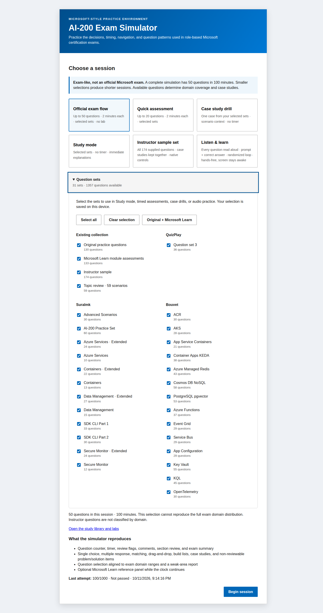
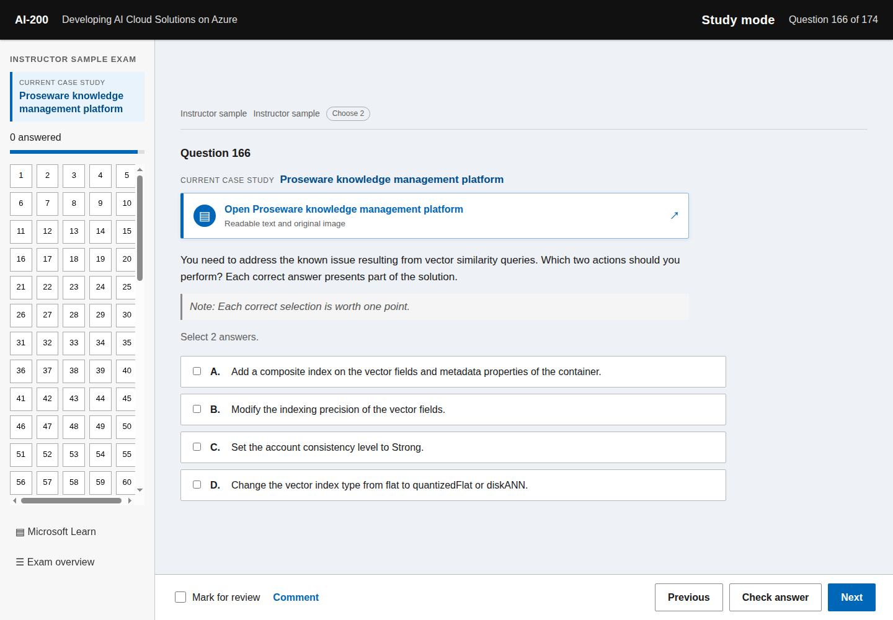
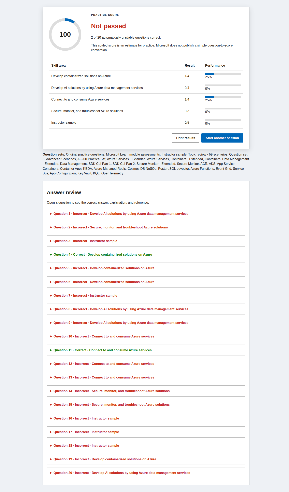

# AI-200 preparation

Persoonlijke studieomgeving voor **Microsoft AI-200: Developing AI Cloud Solutions on Azure**. De repository bevat compacte Nederlandstalige lesnotities, een labtracker, examenvoorbereiding en een Engelstalige oefenapp.

## Inhoud

- `kennisbank/00-overzicht.md` — ingang naar alle aantekeningen.
- `kennisbank/01-lesnotities.md` — doorlopende cursusnotities.
- `kennisbank/03-examenplan.md` — leerplan en examenstrategie.
- `kennisbank/04-labtracker.md` — voortgang van de 24 verplichte labs.
- `kennisbank/14-officiele-examengap-analyse.md` — dekking tegenover de officiële studiegids.
- `kennisbank/17-online-oefenvraagbronnen.md` — beoordeling van openbare oefenbronnen.
- `kennisbank/19-topic-review-59-scenarios.md` — 59 nieuwe scenario's met gecontroleerde antwoorden, afleiders en bronnen.
- `kennisbank/18-community-bronnen-en-controle.md` — leerroute, bronoverzicht en inhoudelijke controle.
- `ai-200-practice-exam/` — Engelstalige simulator met 1.357 vragen in 31 selecteerbare testsets.
- `sources/index.html` — doorzoekbare offline bibliotheek met 184 gidsen en labs, waaronder 23 Naytron-labs; volledige snapshots van alle vier communityrepositories.

Open `ai-200-practice-exam/dist/index.html` lokaal in een browser. Kies onder **Question sets** welke sets meetellen voor **Study mode**, een proefexamen, een korte toets of een casusdrill. De keuze blijft bewaard. Een proefexamen bevat maximaal 50 vragen en gebruikt uitsluitend de gekozen sets; kleinere selecties krijgen een kortere sessie. Via **Open the study library** lees je de gidsen en labinstructies.

De uitbreiding voegt 861 vragen toe: QuizPlay 36, Suralmk 300 en Bouvet 525. De inhoudelijke beoordeling leverde 136 correctie- en verduidelijkingsrecords op. Antwoordstructuren, bronbestanden en selectiegedrag zijn automatisch gecontroleerd. De labs zijn niet in Azure uitgevoerd; de reikwijdte van de controle staat in `sources/review.html`.

## Screenshots

### Startscherm

### Examenvraag met timer en navigatie

### Case study met informatietabbladen

### Supplied scenario als leesbare tekst en origineel beeld

### Zichtbare aanduiding van de actieve case study

### Score en antwoordcontrole

## Privacy en AVG

- Er worden geen cursistgegevens, labaccounts, tijdelijke toegangscodes of ingevulde persoonlijke formulieren gepubliceerd. Bronvermeldingen en openbare auteursgegevens blijven behouden.
- De oefenapp vraagt niet om een naam, e-mailadres of andere persoonsgegevens.
- De browserversies bewaren setkeuzes, actieve sessies, antwoorden, opmerkingen en oefenresultaten in lokale browseropslag. Deze gegevens worden niet door de app naar een server verzonden.
- Vrije opmerkingen blijven lokaal en worden samen met de actieve sessie opgeslagen.
- Voeg nooit `.env`-bestanden, Azure-aanmeldgegevens, TAP-tokens, API-sleutels of exports met persoonsgegevens toe.

Zie ook `PRIVACY.md`.

## Bronnen en status

De applicatie is een onafhankelijk studiemiddel en geen officieel Microsoft-product. De gecontroleerde vraagbank bevat 133 openbaar gepubliceerde Microsoft Learn-moduletoetsvragen met bronvermelding. De afzonderlijke docentenset bevat 174 aangeleverde voorbeeldvragen. Alle 174 gebruiken native tekst en bediening; de 48 oorspronkelijke hot-area-vragen zijn omgezet naar selectierasters en codeblokken. Na visuele dubbelcontrole kan de app alle 174 docentvragen automatisch nakijken. De oorspronkelijke Word-bestanden, antwoordschermen en persoonsgegevens zijn niet gepubliceerd.

Het lokale bestand `bron-oefenvragen.pdf` wordt daarom niet gepubliceerd. De bruikbare beoordeling ervan staat zonder gekopieerde vraagbank in `kennisbank/15-oefenvragen-bronbeoordeling.md`.

Belangrijkste bronnen:

- https://learn.microsoft.com/en-us/credentials/certifications/resources/study-guides/ai-200
- https://learn.microsoft.com/en-us/credentials/certifications/azure-ai-cloud-developer-associate/
- https://learn.microsoft.com/en-us/training/courses/ai-200t00
- https://microsoftlearning.github.io/mslearn-azure-ai/

Azure-diensten en examendoelen veranderen. Controleer vlak voor het examen altijd de actuele officiële studiegids.

## Disclaimer

Microsoft, Azure en de bijbehorende productnamen zijn handelsmerken van Microsoft. Deze repository is niet verbonden aan of goedgekeurd door Microsoft of Pearson VUE.
