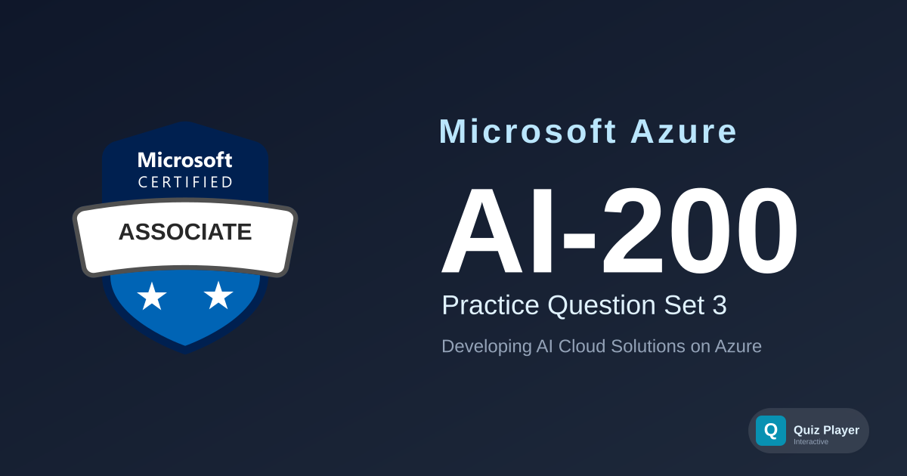

# AI-200 Practice Section 3

Practice questions for the **Developing AI Cloud Solutions on Azure (AI-200)** certification exam — the successor to AZ-204. This third set covers GPU workload profiles, init containers, and troubleshooting on Azure Container Apps and AKS; Cosmos DB TTL, composite indexes, partial document updates, and autoscale throughput; pgvector operator classes, Redis data structures, and Blob Storage lifecycle management; Service Bus deferral and batching, Event Hubs consumer groups and checkpointing, Durable Functions, and API Management policies; plus App Configuration snapshots, OpenTelemetry sampling and custom metrics, Key Vault cryptography, and KQL analysis.

## Content Overview

- **36 Questions** — 12 case-study questions across 4 fictional scenarios plus 24 standalone questions. Single choice, multiple choice, ordering, and matching.
- **Topics**:
  - Develop containerized solutions on Azure (20–25%)
  - Develop AI solutions by using Azure data management services (25–30%)
  - Connect to and consume Azure services (20–25%)
  - Secure, monitor, and troubleshoot Azure solutions (20–25%)

## What This Does Not Cover

This question set focuses on **developer-level service integration, SDK usage, and configuration decisions**. It does not include live coding labs, full IaC template authoring, or portal walkthroughs. It is not a substitute for official Microsoft Learn training paths.

## Disclaimer

> [!IMPORTANT]
> These questions are **AI-generated** for study and practice purposes. They are **not** exam dumps and do not contain actual questions from the Microsoft certification exam. Use them to test your understanding of Azure concepts, not as a substitute for official study materials.

## Usage

This repository is designed to be used with the [Quiz Player](https://quizplay.io). Click the badge above to launch the quiz directly.

## License

This content is licensed under the [GNU Affero General Public License v3.0](LICENSE).
